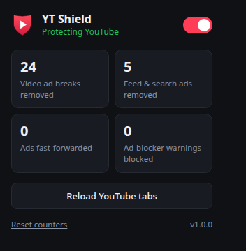
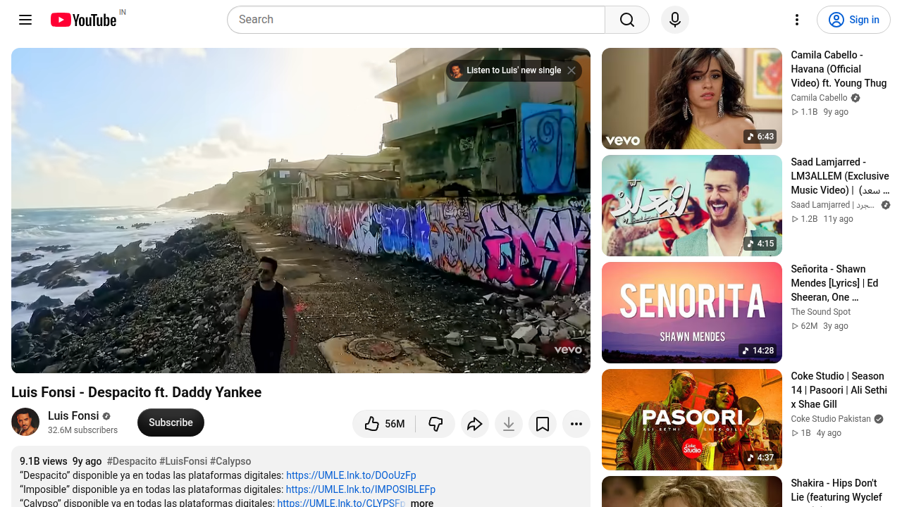
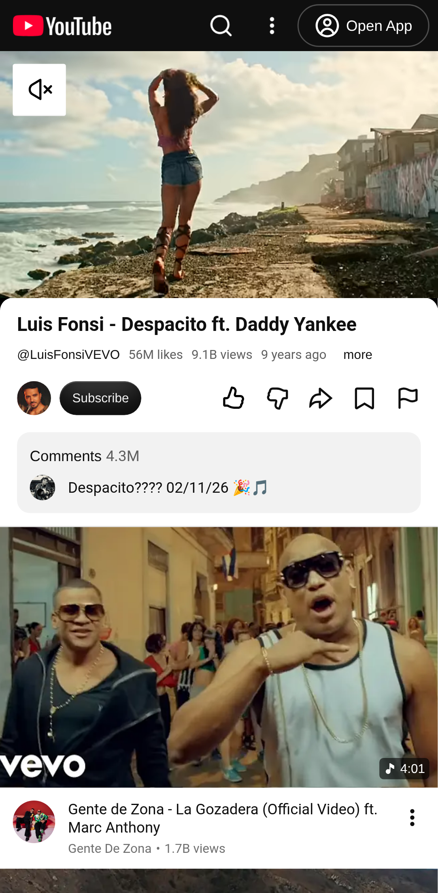
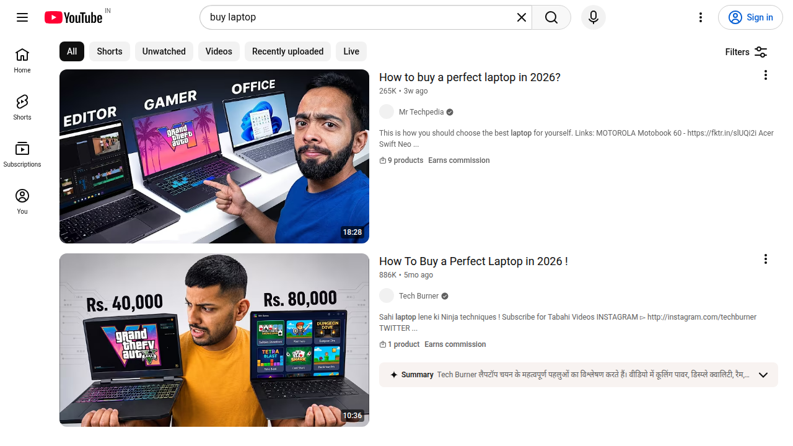

  

<h1 align="center">YT Shield</h1>

<b>A quiet ad remover for YouTube and Spotify that the sites don't notice.</b>

> **Showcase repository.** This page describes the project and shows it working. The source
> code is kept private and is not published here.

---

## The problem

Most ad blockers, including the one built into Opera GX, work by **blocking ad network
requests**. YouTube's player expects those requests to succeed. When they fail, it knows a
blocker is running and shows the *"Ad blockers are not allowed on YouTube"* warning.

## The approach

YT Shield doesn't block a single request. It runs inside the page before any YouTube code
and **removes the ad instructions from the data YouTube sends**, before the player reads it.
The player never learns an ad was planned, so it never asks for one, and nothing fails that
it could detect.

| Layer | What it does |
|---|---|
| **Data pruning** | Strips video ad breaks plus feed, search and Shorts promotions from YouTube's page data and API responses |
| **Stealth** | The few browser functions it hooks still look like untouched built-in code to anything that inspects them |
| **Safety net** | If an ad ever gets through, it is muted, played at 16× and skipped automatically |
| **Warning removal** | If the anti-adblock dialog appears, it is dismissed and playback resumes |
| **Cosmetic backup** | Any leftover ad containers are hidden |

## Spotify web player

New in v1.1: a separate Spotify module inside the same extension, with its own switch.

| Layer | What it does |
|---|---|
| **Empty answers** | Spotify's ad-decision requests get a successful but empty reply, so the player sees "no ad available" instead of a failure it could flag |
| **Safety net** | If an audio ad still starts, it is muted and fast-forwarded, and sound returns with the music |
| **Cosmetic** | Home-page takeovers and ad banners are hidden |

Both modules share one stealth layer, so every hook looks like untouched browser code.

## Platforms

| Where | How |
|---|---|
| Chrome, Opera GX, Edge, Brave | Manifest V3 extension for YouTube and the Spotify web player, with a popup (per-site switches and live counters) |
| Android | Same engine as a userscript in Firefox + Violentmonkey |
| iPhone / iPad | Same engine as a userscript in Safari via the Userscripts app |
| Safari on Mac | YouTube and Spotify userscripts via the free Userscripts app, shipped as a ready-to-send package with an install guide |

One shared engine is built into both the extension and the userscript, so every platform gets
the same protection.

## Screenshots

**Extension popup** (v1.0, before the Spotify section was added)

**Desktop: video starts immediately, no ad** · **Mobile site: no ad**

  
  

**Search results with no promoted listings**

## Test results

Tested automatically against live YouTube:

- **Without YT Shield:** YouTube served ad placements on the test videos.
- **With the extension:** no ad data reached the player, no ad played, no warning appeared,
  and every video played normally. In-app navigation and search results were also ad-free.
- **Mobile userscript:** no ads on the mobile YouTube site.
- **Result:** 15 of 15 live checks passed, and 14 of 14 unit tests (YouTube and Spotify engines).
- **Spotify module:** unit-tested; live testing on a free Spotify account is in progress.

## Built with

JavaScript · Chrome Extensions Manifest V3 · Userscripts · Node.js test runner · Playwright

---

Built by <a href="https://github.com/Jinadev15">Jinadev15</a>. Source available privately.

